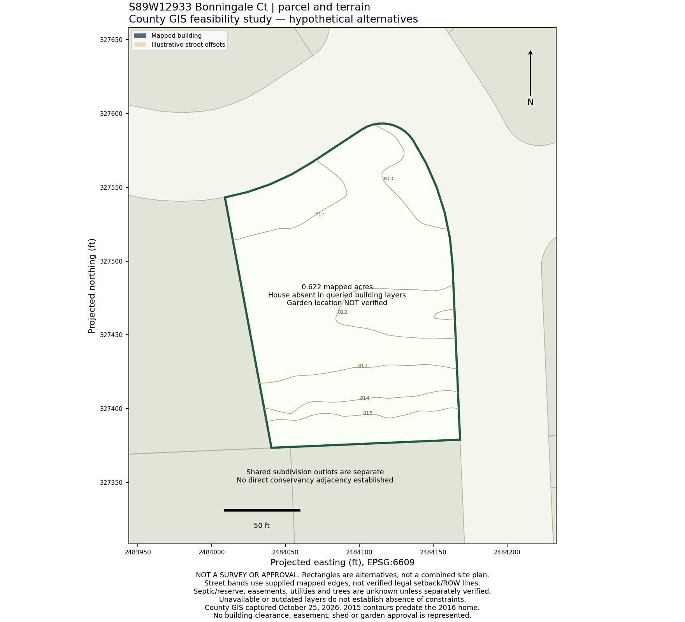

# Property Evaluation — S89W12933 Bonningale Ct, Muskego, WI 53150

Evaluated October 25, 2026. **Verdict: worthwhile to tour if you are comfortable with an open subdivision setting, but not an especially compelling match at $850,000.** The kitchen, useful bedroom arrangement, three-car garage and municipal utilities are strengths. Privacy, family travel and unverified utility/storage space hold it back. Estimated market value **$815,000–$865,000**, midpoint about **$840,000**; moderate confidence. Buyer fit **6.80/10 at 82% weight coverage**. Mudroom and basement-storage categories remain unscored pending actual evidence. Scores do not determine value.

This is a reviewed desktop evaluation, with document/inspection conditions below. Live no-traffic routes are now verified; weekday traffic and comparable interiors remain unverified. This evaluation was completed before the new blind-valuation workflow was added and is explicitly non-blind.

## 1. Initial read / key facts

| Item | Finding / basis |
|---|---|
| Listing | MetroMLS 1985033; LPT Realty |
| Current status / asking price | Active, $850,000, verified October 25 through current Shorewest and Coldwell Banker pages |
| Original price / timing | $850,000; delayed entry Oct. 15, active Oct. 23; about 2 elapsed days active, portal DOM 3 |
| Bedrooms / baths / year | 5 / 3 full + 1 half / 2016, MLS claims |
| Area | **2,337 above grade + 778 finished below = 3,115 total**, current MLS; fifth bedroom is below grade |
| Garage | 3 attached stalls reported; single plus double doors observed, internal dimensions unknown |
| Exclusive land | 0.62 listed/assessed acres; **0.62194613 mapped acres**, parcel MSKC2253025 |
| Municipality / subdivision | City of Muskego, Waukesha County / Aster Hills Estates |
| Utilities | Municipal water/sewer; natural-gas forced air, central AC, MLS claims |
| HOA | $215 reported annually by Movoto; confirm frequency, current budget and assessments |
| Taxes | $7,311 for 2025, MLS/portal corroboration; actual tax bill not retrieved |
| Assessment | Official county GIS **$831,500 for 2026**: $205,000 land + $626,500 improvements; 2025 was $741,400 |
| Mechanical ages | Roof, furnace, AC, water heater and generator installation/replacement dates not documented |

Current listing facts: [Shorewest](https://www.shorewest.com/WI/Waukesha/Muskego/S89W12933-Bonningale-Ct-Muskego-WI-53150/1985033-METRO), [Coldwell Banker](https://www.coldwellbankerhomes.com/wi/muskego/s89w12933-bonningale-ct/pid_74411742/), [Movoto](https://www.movoto.com/muskego-wi/s89w12933-bonningale-ct-muskego-wi-53150-663_1471216/). Reviewed Oct. 25. These are seller/MLS claims, not an inspection.

**History/conflicts:** Redfin retains a December 20, 2016 purchase for $524,900 and historical 2,550 sqft. That conflicts with the current 2,337 above-grade figure. Do not silently combine the old area with the current basement. Obtain a measured floor plan and assessor card. Prior sale is context, not a 2026 valuation input. School snippets mix Bay Lane elementary/middle labels and older assignments; verify attendance with the district. [Redfin subject](https://www.redfin.com/WI/Muskego/S89W12933-Bonningale-Ct-53150/home/104536191).

## 2. Buyer-fit review

### Kitchen — 8/10

Photos 5–9 show a practical kitchen: uninterrupted island prep surface with seating, perimeter sink/window and dishwasher, gas range with a separate hood, substantial base cabinets and an extra counter/beverage area by the dinette. The island avoids dedicating its main surface to a sink or cooktop. This should work well for cooking while watching the adjacent living/dining spaces.

The dark cabinets and narrow mosaic backsplash read as good mid-2010s finishes. They do not establish a recent renovation. The kitchen is useful rather than exceptionally large; test two-person circulation with the dishwasher open and stools occupied. Hood ducting outdoors, cabinet hardware condition, refrigerator clearance and pantry capacity require a tour. Pantry is explicitly listed, but no open pantry interior was photographed; provisional pantry fit 7/10.

### Garage entry / mudroom — unknown, unscored

The main-floor utility/laundry room is listed at 10×6. No dedicated photo or floor plan proves the direct garage route, lockers, coat storage or usable drop zone. Sixty square feet shared with laundry could be tight. Walk the actual garage → shoes/coats/bags → kitchen path. A room dimension alone is insufficient evidence for a proper mudroom.

### Garage / shed / outbuilding — 7.5/10 provisional

The single and double overhead doors support the reported three-car configuration. That is the primary storage advantage. There is no interior view to establish depth, the width of the third stall, stair intrusion or room for two vehicles, shelving and mower/tools. Bring vehicle dimensions and measure clear wall-to-door depth.

No garden shed was identified in the 37-photo set; absence from the set does not prove none exists. Small-shed permission is **unknown**, not prohibited. A modest garden shed would help preserve garage capacity, but no large-workshop penalty is applied to this subdivision house. Municipal and HOA requirements are separate; see Section 5.

### Basement utility/storage — unknown, unscored

Photos 22–26 show finished recreation space, a fifth bedroom with a window well and a full bath. The finished spaces look useful, but unfinished utility/storage space is not shown. Do not equate a full basement with adequate remaining storage, or the portal FAQ's “fully finished” phrase with a measured finish percentage. Confirm unfinished dimensions, shelving, sump access, dryness and mechanical clearances. Verify bedroom egress, basement permits and whether visible supplemental baseboard heating is electric and separately controlled.

### Garden / outdoor — 7.5/10 provisional

Photos 27–35 show a broad, open lawn with comparatively modest tree cover, a paved patio and fire pit. This is promising for sunny vegetables and practical play. A 30×40 garden looks plausible, but no accurately located rectangle has been established clear of trees, easements, drainage and fencing constraints. Photos are not a sun-hour study or boundary survey. Municipal utilities remove the usual septic-field conflict, subject to verification of actual service.

The tradeoff is **exposure**: multiple nearby houses and streets are visible from the patio and main living windows; young screening trees do not create wooded seclusion. Lot/privacy fit 4.5/10. A garden and play lawn may be easier here than on wooded acreage, but it is not a nature/privacy purchase.

## 3. Best comps and value

All below are sold comparables, not asking-price substitutes. Distances are approximate neighborhood/map context, not measured driving routes. Live sold portals commonly retained only one exterior photo. Multiple alternate gallery attempts failed or returned 404; **interior descriptions below remain MLS claims, not independently inspected interiors**. No adjustment is presented as a formal appraisal adjustment.

| Comp | Sale / size / setting | Weight and interpretation |
|---|---|---|
| **S89W13007 Bonningale Ct**, same court, roughly 0.1 mile | **$815,000, Aug. 17, 2026**; 2017; 4BR/2.5BA; 2,295 above-grade sqft; 0.55 acre; 2.5-car garage; inground pool, basement with future-finish potential | Highest location/age/layout relevance. Subject adds finished lower bedroom/bath, about 42 above-grade sqft and garage/land capacity; comp has pool and claimed white-shaker/quartz kitchen. Do not simply add full basement construction cost to its sale. |
| **W129S8726 Boxhorn Reserve Dr**, same subdivision, within about 0.5 mile | **$845,000, Aug. 5, 2026**; 2017 ranch; 3BR/2BA; 2,174 sqft; 0.53 acre; 3.5-car garage; unfinished basement | Strong neighborhood price anchor. Claims newer quartz/backsplash/flooring, pantry, mudroom and 11-foot ceilings. Subject offers more finished space/baths; ranch plan, larger garage and claimed updates support the comp's price. |
| **W140S6982 Twin Silos Ct**, roughly 2.5 miles north | **$835,000, Oct. 20, 2026**; 2026 construction; 4BR/2.5BA; 2,770 sqft; 0.59 acre; 3-car garage; unfinished lower level | Useful fresh upper-market cross-check. Subject's basement finish and mature patio offset some age difference; comp supplies about 433 more above-grade sqft, new systems and main-floor primary. Less weight than same-subdivision sales. |
| **W125S8568 Country View Ct**, within about 1 mile | **$775,000, July 30, 2026**; 2000 ranch; 4BR/3BA; 3,158 total sqft, grade split unverified; 0.51 acre; 2.75-car garage | Lower bracket, older construction, walkout lower level and claimed conservancy outlook. Less direct age/layout match; total sqft is not interchangeable with above-grade space. |

Sources: [Bonningale closing record](https://www.powersrealty.com/sold-property?Address=S89W13007-Bonningale-Ct-Muskego-WI-53150&ListingId=1967777), [Bonningale MLS history](https://www.redfin.com/WI/Muskego/S89W13007-Bonningale-Ct-53150/home/144979668), [Boxhorn sold record](https://www.redfin.com/WI/Muskego/W129S8726-Boxhorn-Reserve-Dr-53150/home/144979687), [Twin Silos sold record](https://www.redfin.com/WI/Muskego/W140S6982-53150/home/199153114), [Country View sold brokerage record](https://www.atproperties.com/1962429/w125s8568-country-view-ct-muskego-wisconsin-53150-swi). Retrieved Oct. 25. Stale $795,000 Boxhorn/$800,000 Bonningale asking pages do not supersede the documented closings. Movoto's Bonningale headline sale date conflicts with its own Aug. 17 event history; use corroborated Aug. 17.

**Reconciliation:** Same-court $815k establishes a strong base. Subject's finished basement/bath/bedroom and nominal third stall merit a premium, partly offset by the comp's pool and different kitchen/lot presentation. The $845k ranch supports this neighborhood's ability to transact in the mid-$800s, while the $835k new build limits an automatic premium for 3,115 combined sqft. These relationships bracket **$815k–$865k, midpoint ~$840k**. Condition, verified area, functional storage and legal outdoor use could shift the conclusion within that band. The asking price was visible from the outset; this is not a blinded valuation. Neither assessment nor automated estimates set the range.

## 4. Photo / condition analysis

All **37 current subject images were opened individually** at downloaded 951-pixel width. Public manifest preserves the observed gallery links; image binaries stay private.

- **1, 30, 34–35:** maintained landscaping, side-entry garage, broad drive, stone accents and horizontal siding; roof surfaces appear broadly orderly at photo scale. Roof age, flashing and siding details need close inspection.
- **2–4, 10–13:** bright main living areas, office, separate dining area, fireplace and open stair. No obvious major cosmetic project. Photographic brightness does not establish full-day light or concealed condition.
- **5–9:** kitchen observations above; no evidence warranting a “recent full renovation” claim.
- **14–21:** four upper bedrooms, primary sitting area, large closet visible through doorway, separate shower/tub and dual vanity arrangement. This keeps the children's bedrooms on the same level as the primary. Primary sitting area could serve nursery/quiet space, but is not an additional enclosed bedroom.
- **22–26:** finished basement appears more recently styled than upper finishes, with contrasting dark doors/trim and a wood-tone vanity. Renovation date/permits and concealed moisture are unknown. Bedroom window well merits egress/drainage review.
- **27–33:** substantial patio/fire pit and open grass; useful entertaining/play setting, low visual privacy. Check paver settlement, wall movement and grading after rain.
- **36:** aerial lake/wetland context image, **not evidence of owned frontage, lake access or a lake view from the house**. MLS reports no waterfront/access.
- **37:** twilight marketing image adds no reliable condition evidence.

No garage interior, laundry/drop-zone interior, unfinished storage room, foundation inspection view or readable mechanical serial labels. No seller disclosure, repair receipts or inspection report was available. Cosmetic presentation is good; hidden condition remains untested.

## 5. Lot / GIS / environmental / restrictions

Official [Waukesha County parcel layer](https://gis.waukeshacounty.gov/host/rest/services/Web_Tax_Parcel/MapServer/2) capture Oct. 25 uniquely resolved MSKC2253025. Mapped area ~27,093 sqft; bounding extent about 159×220 feet is **not** a rectangular usable yard dimension. GIS confirms the parcel, not a staked boundary.

Configured county queries returned no intersecting wetland polygons/points, environmental corridor, other regulatory floodplain or septic-index features. FEMA polygon identifies **Zone X / area of minimal flood hazard**, SFHA false. This is reassuring mapped evidence, not a guarantee against groundwater, surface drainage or unmapped wetlands. Sources: [Environmental](https://gis.waukeshacounty.gov/host/rest/services/Environmental/MapServer), [Floodplains](https://gis.waukeshacounty.gov/host/rest/services/Floodplains/MapServer).

Historical one-foot contours cross at approximately 811–815 feet. They predate the 2016 house and cannot establish current grading/drainage. Both queried building layers failed to represent the visible house; no footprint clearance or automated garden placement is accepted. The map intentionally shows no proposed building/garden rectangle. Raw capture success does not cure stale/incomplete geometry.

**Development/open space:** Municipal [PD-49 ordinance](https://ecode360.com/32210226) describes 53 parcels on ~63.5 acres, underlying RS-2, municipal utilities, 30-foot setbacks and 15-foot side setbacks unless final plat differs. Separate outlots serve stormwater/open space/future park purposes. This supports a planned residential setting, **not subject ownership of those acres or permanent privacy behind this particular yard**. Direct conservancy adjacency, deeded outlot interest and protection of any specific view remain unverified. Photos show an established neighborhood; future infill, park activity and zoning changes cannot be ruled out.

**Garden shed/fencing:** Municipal [§400-167](https://ecode360.com/29722805) generally permits one garden shed ≤120 sqft, with location/height/architectural conditions. A shed must respect all street-yard setback lines; matching materials/style and permits matter. Resin/portable status is no exemption. The code allows fences with a zoning permit, on the owner's land, subject to height/material rules. **Recorded HOA covenants and architectural rules were not obtained**, so neither a specific resin/wood shed nor garden fence is approved here. Obtain written city and HOA answers for the actual size, material and site. Do not substitute the ordinance's general allowance for parcel-specific authorization.

## 6. Location / drive-time tradeoffs

The subject is in southeastern Muskego near North Cape/Durham. After direct approval, Nominatim geocoding and OSRM routing were obtained October 25, 2026. Subject origin uses county parcel geometry; the work address unit was omitted for building geocoding. Routes are **no-traffic estimates**, compared with saved no-traffic baselines—not a fresh matched reroute from the current home.

| Destination | Saved baseline | OSRM candidate | Distance | Change |
|---|---:|---:|---:|---:|
| Lisa's Work | 31 min | **28.7 min** | 15.7 mi | **−2.3 min**, slightly better |
| Sam's Parents | 35 min | **57.1 min** | 36.7 mi | **+22.1 min**, materially worse |
| Lisa's Mom | 25 min | **49.7 min** | 32.5 mi | **+24.7 min**, materially worse |

These replace the earlier geographic planning ranges. The parents trip is worse than initially estimated. Route choice/provider can differ from Google Maps and real driving; no weekday traffic forecast was acquired. The family-trip penalties remain a meaningful disadvantage. Location fit stays 5.5/10; the overall score and market-value range remain unchanged. Sources: [Nominatim](https://nominatim.openstreetmap.org/) and [OSRM](https://project-osrm.org/); private address-bearing inputs/URLs are not published.

## 7. Taxes / major-cost concerns

At the $850k ask, historical $7,311 taxes equal **0.86%** of price, about **$609/month**; at $840k, about 0.87%. HOA at a reported $215/year adds ~$18/month. Confirm dues frequency and special assessments. These are historical carrying-cost figures, not a 2026 tax quote.

The county's 2026 assessment is $831,500, about 12.2% above 2025. Its 2026 tax fields are zero/unpopulated; **that does not mean zero taxes**. Assessment changes do not imply an equal percentage change in the bill. As a sensitivity calculation only, holding the prior tax-to-assessment ratio constant yields roughly $8,200/year; changing mill rates, credits and charges can produce a different bill. Budget conservatively until the actual bill is known.

A ten-year-old house is encouraging relative to older remodel candidates, but no replacement-age premium is earned without records. Request roof/HVAC/water-heater ages and service history, generator transfer-switch permit/service test, radon-system test, sump/backup details, basement waterproofing history and finishing permits. Municipal utilities avoid private well/septic replacement exposure. Obtain an independent inspection covering foundation, moisture, roof/siding, electrical and gas equipment. No contractor quotes were obtained, so no precise repair allowance is invented.

## 8. Questions / documents before offering strongly

1. **Garden/shed/fence:** current survey/final plat, drainage/utility easements, recorded HOA declaration/amendments and ARC standards; written approval pathway for a 30×40 fenced garden and a small resin/wood shed.
2. **Storage:** measure each garage stall and photograph interior; establish direct garage entry, coat/shoe/bag storage, pantry shelving and usable unfinished basement dimensions.
3. **Condition:** seller disclosure, water intrusion/sump history, roof/mechanical/generator receipts, basement permit/final inspection, fifth-bedroom egress and current radon test.
4. **Area/title/costs:** resolve 2,337 vs 2,550 above-grade sqft, deed/title Schedule B exceptions, outlot rights, current HOA dues/assessments and actual 2026 tax bill.
5. **Location:** verify weekday work-trip traffic and preferred family-route alternatives; school boundary confirmation.

## 9. Offer strategy / verdict

| Decision | Guidance, conditional on inspection and outdoor-use feasibility |
|---|---|
| Opening | **$810k–$820k** if no competition; reasonable buyer opening, not a prediction of acceptance after two active days |
| Reasonable purchase | **$825k–$840k** |
| Caution | **$850k**: market-defensible, but little buyer-specific cushion for privacy/family travel and unresolved storage |
| Walk-away | **$860k** for this buyer under present evidence; reconsider downward if garden/shed/storage fails |

Do not waive inspection or restrictions review to justify the price. If competing offers are real, $840k–$850k could be defensible after a strong tour, but there is no compelling reason to chase above the asking price for this particular fit. A legally impractical garden or insufficient garage/storage should change the buy decision, not merely trigger a token discount.

**My read:** good house, ordinary subdivision land. The kitchen and bedroom arrangement could make daily life comfortable with relatively little cosmetic work. It supplies functional yard space rather than seclusion. Tour it if a newer, convenient house matters more than the privacy/nature goal; otherwise keep it behind properties offering stronger setting and family access at similar cost. The current asking price is plausible from sales, but it does not compensate you for those tradeoffs.
